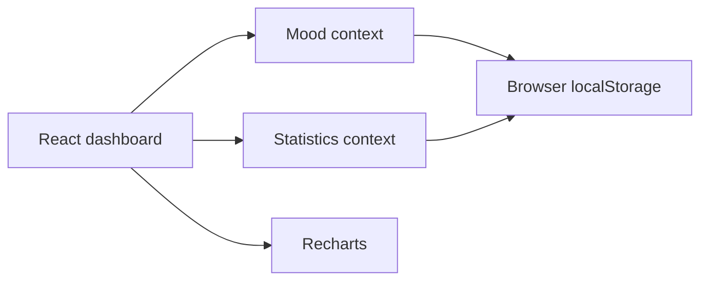

# DevMood

**A mood-aware focus dashboard that pairs a Pomodoro timer and task list with small, personal progress signals.**

[](https://github.com/Abdullah-Mohammed456/DevMood/actions/workflows/ci.yml)
[](LICENSE)
[](tsconfig.app.json)
[](vercel.json)

**Demo:** Not currently deployed; use the local setup below.

## Features

- Pick a current mood; the selected mood updates the dashboard accent and motivational quote.
- Run configurable work and break sessions with sound and optional browser notifications.
- Add, complete, and delete tasks; task data is saved in browser storage.
- See daily Pomodoro, task, and streak counts.
- Compare recent task and Pomodoro activity in a weekly chart.
- Use responsive layouts, keyboard focus indicators, and reduced-motion support.
- Keep all current data in the browser; there is no account, backend, or database.

## Tech stack

- React 19 and TypeScript 6 with strict type checking
- Vite 8 and Tailwind CSS 4
- Recharts for activity visualizations
- Framer Motion for small interface transitions
- date-fns for dates, Lucide for icons, and localStorage for persistence
- ESLint and Prettier

## Architecture

DevMood is a client-only single-page application. React context holds the selected mood and session statistics; task, mood, and statistics state persist in localStorage. Recharts reads the saved activity history. No backend service or database is part of the current repository.



The mood distribution chart currently displays clearly labeled example values because the app does not yet record mood history over time. The weekly activity chart uses saved statistics; new profiles start with an empty history rather than random sample days.

## Getting started

### Prerequisites

- Node.js `22.13.0` or later
- npm

### Install and run

```bash
npm ci
npm run dev
```

Vite prints the local development URL after startup.

### Environment variables

No environment variables are required for the current client-only application. `.env.example` is intentionally comment-only; never add real credentials to it.

| Variable | Required | Purpose |
| --- | --- | --- |
| None | — | The app has no API server or external service configuration. |

### Build, checks, and tests

```bash
npm run lint
npm run typecheck
npm run format:check
npm run build
```

There is no automated unit or browser test suite yet. CI currently runs dependency installation, audit, lint, type checking, and a production build.

## Deployment

The Vercel configuration builds the Vite app with `npm run build` and serves the `dist` directory. No environment variables are needed. Connect this GitHub repository to Vercel, keep the framework preset on Vite, and deploy the `main` branch when ready. Preview deployments can be enabled for pull requests.

For a manual deployment with the Vercel CLI:

```bash
npm ci
npm run build
npx vercel
npx vercel --prod
```

The app has no backend, database, Render service, or Neon connection to configure. After deployment, add the resulting Vercel URL to the live-demo line above and set the canonical Open Graph URL if one is introduced.

## Project structure

```text
.
├── .github/workflows/ci.yml  # Continuous integration
├── design-previews/          # Three isolated design concepts and research notes
├── public/                   # Static icons
├── src/
│   ├── components/           # Dashboard, timer, tasks, statistics, charts
│   ├── constants/            # Mood labels, colors, and quotes
│   ├── context/              # Mood and statistics state
│   ├── App.tsx               # Providers and dashboard layout
│   ├── index.css             # Visual system and responsive styles
│   └── main.tsx              # Entry point
├── .env.example
├── CONTRIBUTING.md
├── LICENSE
├── vercel.json
└── vite.config.ts
```

## Roadmap

- Add unit and browser-level tests for timer, task, and storage flows.
- Record mood history so the mood distribution chart can show real user data.

## Contributing

Read [CONTRIBUTING.md](CONTRIBUTING.md) for local setup, branch, formatting, and pull request guidance.

## License

Distributed under the [MIT License](LICENSE).

## Contact

Open a GitHub issue for bugs or feature requests, or visit [Abdullah-Mohammed456 on GitHub](https://github.com/Abdullah-Mohammed456).
